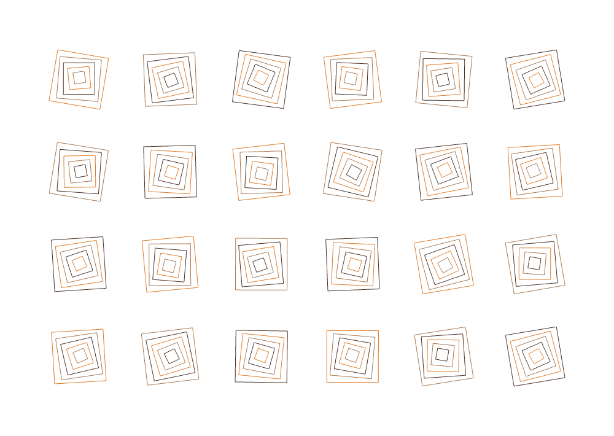

# TouchDesigner Plotter Art

Create reproducible vector artwork in TouchDesigner, then export millimetre SVGs for a pen plotter. **Milestone 01: Nested Currents** is an adjustable grid of nested, gently rotated squares.



## Open and use

1. Open **`Nested_Currents_Milestone_01.toe`** in TouchDesigner. The tested Mac build is **2025.33230**. No extra Python packages are needed.
2. Select the **nested_currents** node. Its **Artwork** parameter page has seed, columns, rows, outlines, rotation, centre drift, margin, pen width and palette controls. Press **Next seed** for a new variation. Press **P** if the parameter panel is hidden.
3. Choose the **Export** page, then **Export postcard SVG** or **Export on A4 carrier**. Files go into `exports` beside the project by default. The last file is shown in the panel. Existing exports receive a numbered suffix rather than being replaced.
4. Load the SVG in SVG Plotter with **Keep original size and position**, **0° rotation**, and **Outline paths**. Match the page size to the export as described below.

For a larger preview, use the node's **View** command from its right-click menu. The reusable **`Nested_Currents.tox`** can also be dragged into another TouchDesigner project. It embeds the same generator and exporter.

## Paper and pens

| Export | SVG page | SVG Plotter page | Physical placement |
| --- | --- | --- | --- |
| Postcard | 148 × 105 mm | Postcard, or Custom 148 × 105 mm | Card top-left at the plotter origin |
| A4 carrier | 210 × 297 mm | A4 portrait | Card top-left at **(31, 96) mm**, bottom-right at **(179, 201) mm** |

The default postcard margin is 8 mm. Actual ink paths occupy approximately **124.4 × 81.1 mm**; this is smaller than the postcard because of the margins and spacing between cells. Neither export adds paper outlines or registration marks. Use separate carrier positioning marks if needed.

The colour palette matches these identifiers in SVG Plotter's existing pen catalogue:

| Pass | Pen | Preview colour |
| --- | --- | --- |
| 1 | Pigma Micron Orange 05, 35781 | `#df7b28` |
| 2 | Pigma Micron Light Brown 05, 35783 | `#a97850` |
| 3 | Pigma Micron Dark Brown 05, 37741 | `#493126` |

These are illustrative screen colours, not measured ink matches. The Black palette gives one pen pass. Pen width records the intended stroke width in the SVG; actual width depends on the physical pen and paper. Very dense control settings can merge strokes on paper.

## Examples

- `examples/nested-currents-seed-42.svg`: default postcard, 120 outlines / 480 segments / about 3.64 m of pen-down travel.
- `examples/nested-currents-seed-42-a4-carrier.svg`: the same artwork positioned on A4.
- Seeds **137** and **2026**: additional reproducible variations.
- `examples/first-pen-test.svg`: 18 black outlines for a simpler physical trial at postcard size.

Every SVG contains JSON metadata, and every export has a matching `.json` file recording settings, generator version, pen colours, placement, path statistics and a geometry checksum. Reproducing geometry requires the same generator version and settings as well as the seed.

## Validation

The nine automated tests were written before the implementation and pass under Python 3.13. They check reproducibility, square geometry, control validation, margins at extreme settings, monochrome conversion, SVG structure, metadata regeneration, carrier translation and preservation of previous exports.

The real TouchDesigner project was exercised on the Mac: the SOP vertices match the exported geometry, seed changes and restoration work, monochrome mode works, and both export types succeed without operator errors. See `docs/touchdesigner-verification.json`.

The SVG exported from TouchDesigner was loaded in **SVG Plotter 1.8.1**, at original size on A4 with 0° rotation. It produced **26,202 checked commands**, reported **124.4 × 81.1 mm** of drawing, and automatically selected the three intended Micron pens. This is import and command validation; **a physical plot has not yet been run**. See `docs/plotter-verification.json`.

## Python use and tests

Python 3.11 or later, standard library only:

```sh
python3 -m unittest discover -s tests -v
python3 -m plotter_art --seed 42
python3 -m plotter_art --seed 137 --rotation 45 --rings 6
python3 -m plotter_art --palette black --columns 3 --rows 2 --rings 3
python3 -m plotter_art --settings examples/nested-currents-seed-42.json --carrier
```

## Structure and rebuilding

`plotter_art/core.py` contains immutable settings, geometry classes and the SVG exporter. `touchdesigner/` contains the adapter callbacks and a project builder. The preview and exporter call this same geometry implementation. SVG paths contain explicit coordinates, no images, external fonts, transforms, clipping or effects.

To rebuild after editing source, open a fresh TouchDesigner project and use **Dialogs → Textport and DATs**. Replace the path in both places below:

```python
script = '/absolute/path/touchdesigner-plotter-art/touchdesigner/build_project.py'
exec(compile(open(script).read(), script, 'exec'), dict(globals(), __file__=script))
```

The builder creates `/nested_currents` and saves `Nested_Currents.tox` and `Nested_Currents_Milestone_01.toe`. It refuses to replace an existing `/nested_currents` component and preserves other operators in the open project. TouchDesigner may ask before replacing an earlier generated project. If source changes, rebuild the native files too: the distributed native files embed their source rather than linking to external Python files.

## References and acknowledgements

- [Okamirufu Vizualizer: TouchDesigner and generative art](https://youtu.be/1RD83NjwNIk): rules, repeated geometry, noise and feedback.
- [Dan Catt: What is generative art?](https://youtu.be/ko6YCbfKtQg): artistic instructions and reproducible pseudorandomness.
- [Derivative: Script SOP](https://derivative.ca/UserGuide/Script_SOP) and [custom parameters](https://derivative.ca/UserGuide/Custom_Parameters).
- [SVG Plotter](https://github.com/GWB2025/svg-plotter-ta4).

Nested Currents is an original implementation exploring the familiar generative-art motif of nested squares. It does not include copied tutorial project files. The referenced creators have not endorsed this project.

## AI assistance

Developed by Gordon Brindle with assistance from OpenAI ChatGPT/Codex for implementation, testing and documentation. Gordon defines the project goals and reviews the results. Software and artwork still require practical judgement and physical testing.

## Licence

MIT; see `LICENSE`. TouchDesigner and other third-party software remain subject to their own licences.
